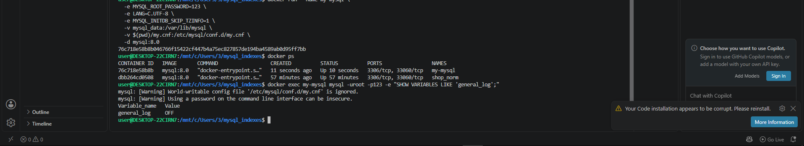
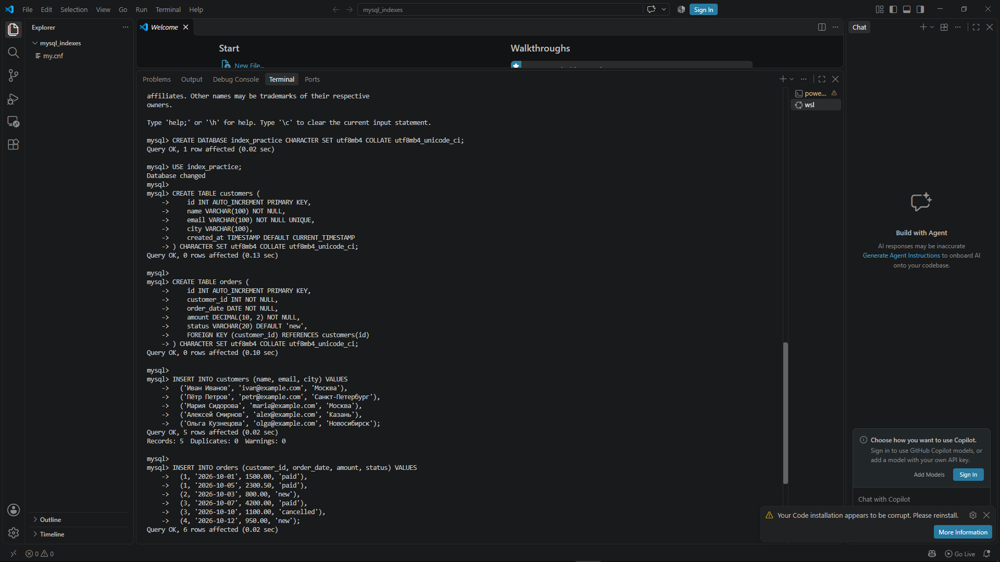
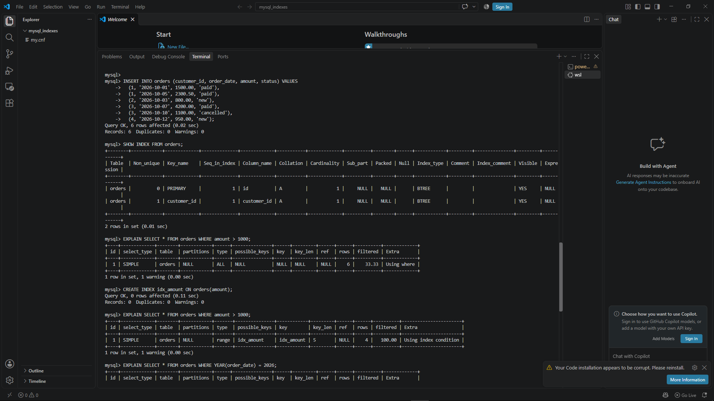
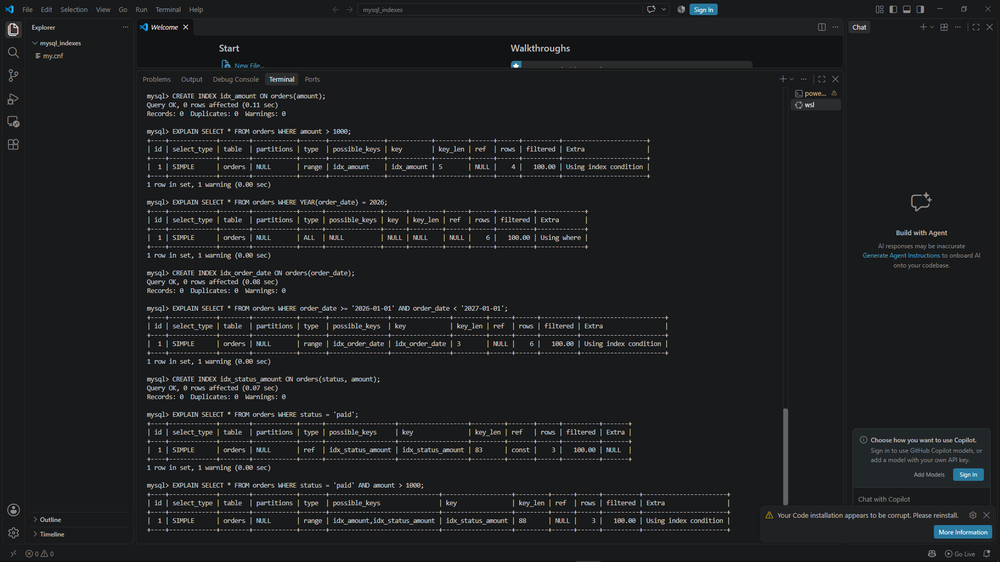
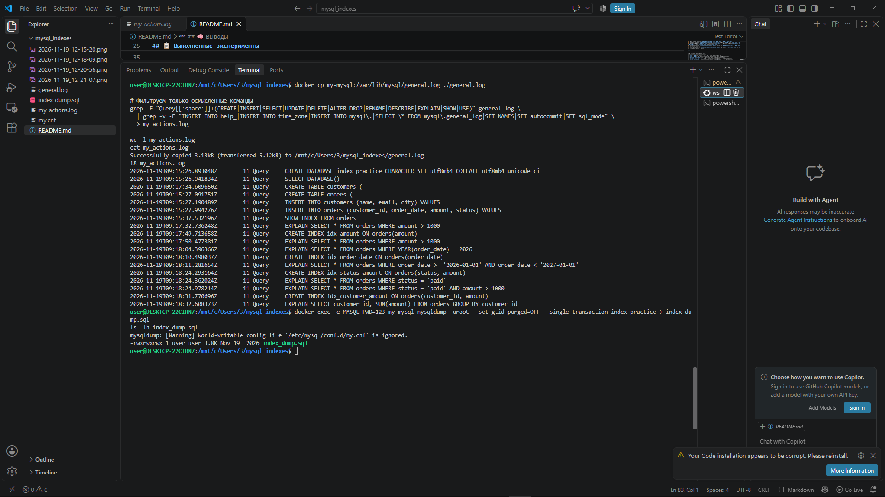
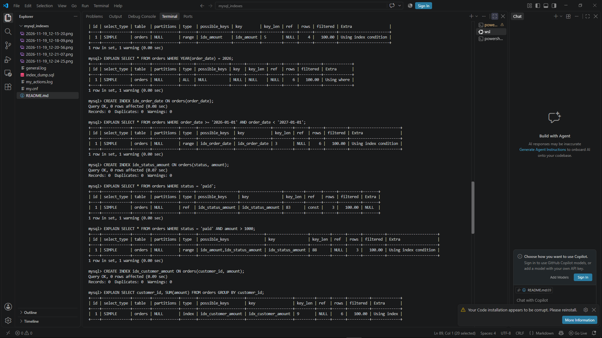

Практическое руководство по созданию индексов, анализу планов выполнения запросов (`EXPLAIN`) и ведению лога действий.

---

## 👨‍🎓 Информация о студенте

| Поле | Значение |
|------|----------|
| **ФИО** | Котохин Артём Ильич |
| **Курс** | 3 |
| **Специальность** | 09.02.07 «Информационные системы и программирование» |
| **Дата выполнения** | 19 ноября 2026 г. |
| **Среда выполнения** | WSL (Ubuntu) + VS Code + Docker |

---

## 🎯 Цель работы

Научиться создавать индексы, читать план выполнения запроса (`EXPLAIN`) и понимать, когда индекс работает, а когда — нет.

---

## 📋 Выполненные эксперименты

1. **Просмотр существующих индексов**: `SHOW INDEX FROM orders;` (автоматически созданы PRIMARY и по внешнему ключу).
2. **Full Scan без индекса**: `EXPLAIN SELECT * FROM orders WHERE amount > 1000;` → `type: ALL`.
3. **Создание индекса**: `CREATE INDEX idx_amount ON orders(amount);` → после `EXPLAIN` стало `type: range`, `key: idx_amount`.
4. **Функция в WHERE**: `YEAR(order_date)` ломает индекс (`type: ALL`). Переписано на диапазон `order_date >= '2026-01-01' AND order_date < '2027-01-01'` → индекс `idx_order_date` заработал (`type: range`).
5. **Составной индекс**: `idx_status_amount (status, amount)` работает для `WHERE status = 'paid'` и `WHERE status = 'paid' AND amount > 1000` (правило левого префикса).
6. **Покрывающий индекс**: `idx_customer_amount (customer_id, amount)` дал результат `Extra: Using index` для `GROUP BY`, что означает чтение только из индекса без обращения к таблице.

---

## 📊 Результаты EXPLAIN

| Запрос | type | key | Extra | Вывод |
|--------|------|-----|-------|-------|
| `amount > 1000` (без индекса) | ALL | NULL | Using where | ❌ Full scan |
| `amount > 1000` (с idx_amount) | range | idx_amount | Using where | ✅ Использует индекс |
| `YEAR(order_date) = 2026` | ALL | NULL | Using where | ❌ Функция ломает индекс |
| `order_date >= ... AND < ...` | range | idx_order_date | Using where | ✅ Диапазонный поиск |
| `GROUP BY customer_id` | index | idx_customer_amount | **Using index** | ✅ Покрывающий индекс |

---

## 🛠️ Технологии

- **ОС:** Windows 11 + WSL (Ubuntu)
- **СУБД:** MySQL 8.0 (Docker)
- **IDE:** Visual Studio Code (Remote-WSL)
- **Терминал:** Bash (WSL)
- **Контроль версий:** Git + GitHub

---

## 📁 Структура репозитория

```
mysql_indexes/
├── README.md
├── my.cnf
├── index_dump.sql
├── general.log
└── my_actions.log
```

---

## 🧠 Выводы

1. Индекс превращает `Full Scan` (`ALL`) в быстрый поиск (`range` или `ref`).
2. Функции над столбцами в `WHERE` (`YEAR()`, `LOWER()`) делают индекс бесполезным. Условие нужно переписывать в виде диапазона.
3. Составные индексы работают строго по **правилу левого префикса**.
4. Покрывающий индекс (`Using index`) — самый эффективный способ выполнения запроса, так как таблица вообще не читается.
5. WSL + `grep` — идеальный инструмент для фильтрации `general.log` без проблем с кодировкой.

---

> **Котохин А.И.**, 3 курс, 09.02.07
---






